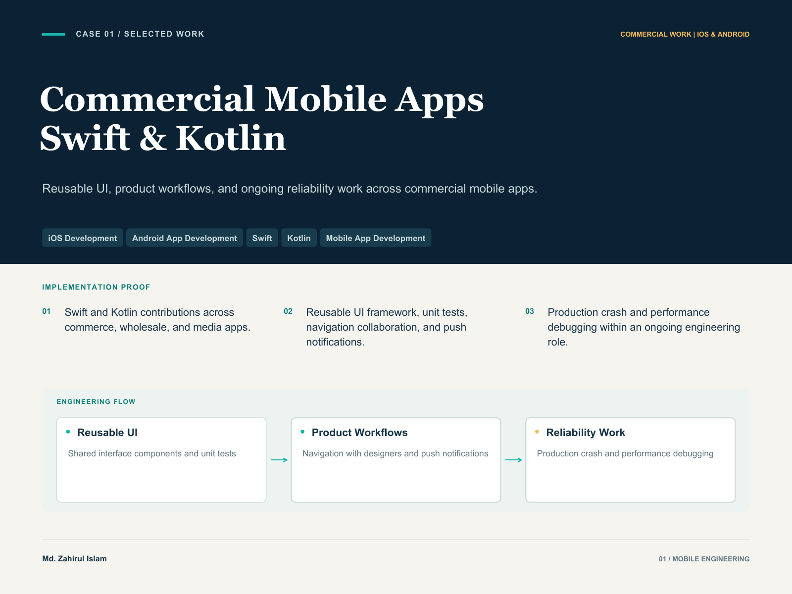
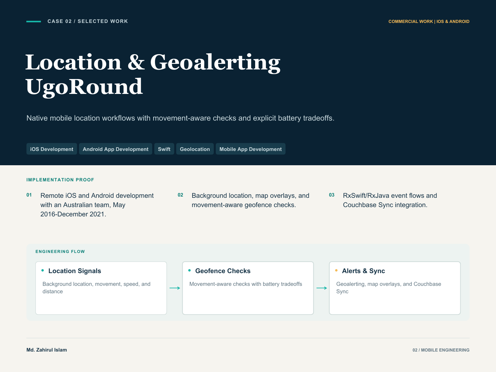
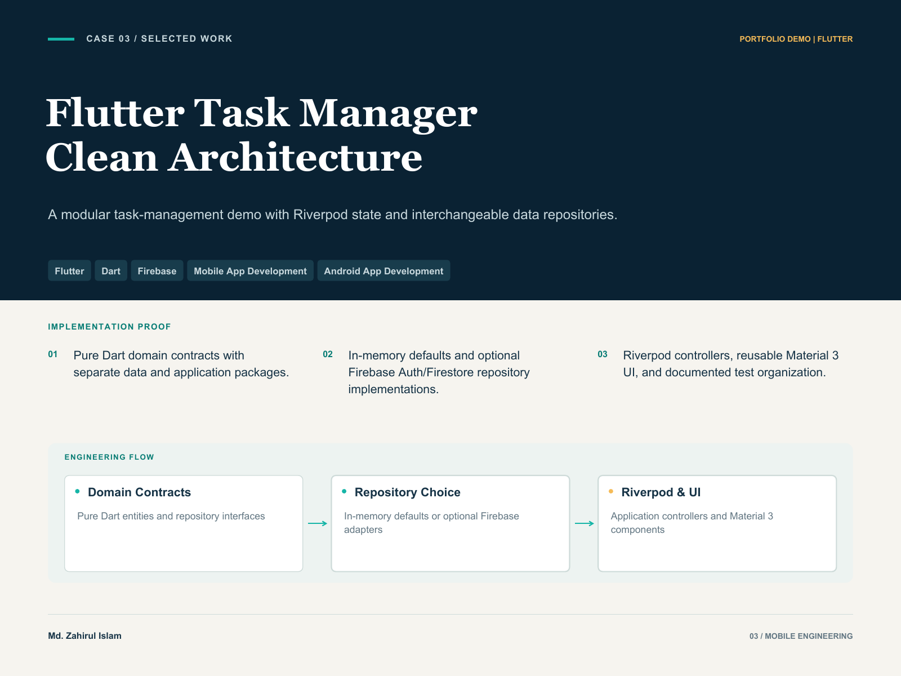
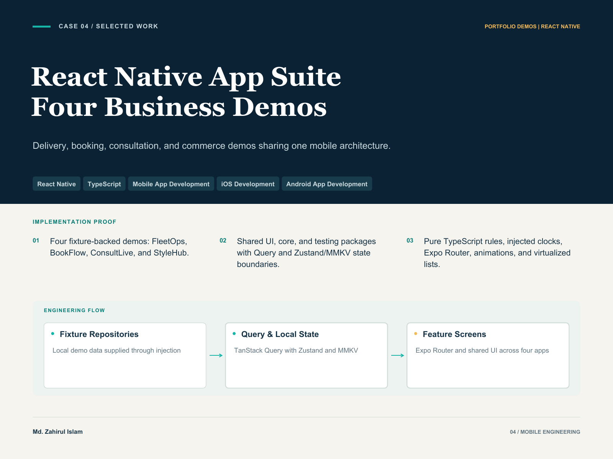
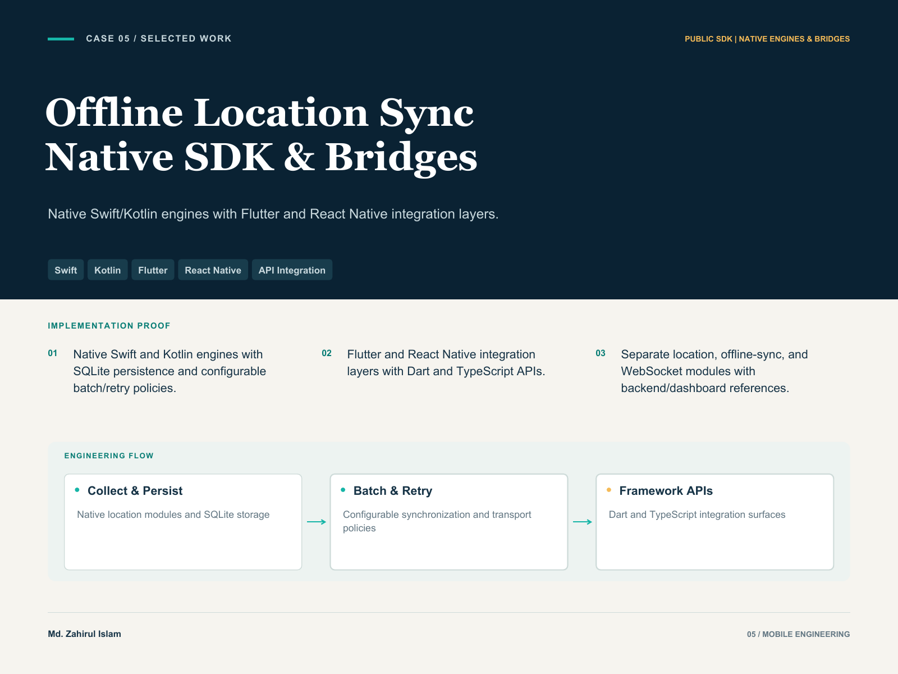
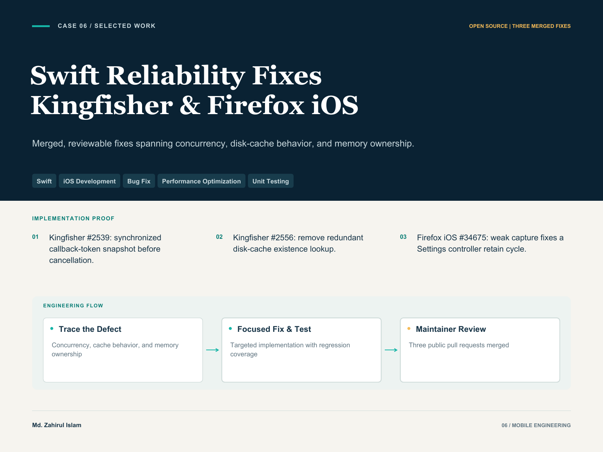

# Md. Zahirul Islam — Mobile Engineering Case Studies

**Senior Mobile Engineer · iOS · Android · Flutter · React Native**

10+ years of total mobile engineering experience, including commercial native delivery, public SDK work and cross-platform portfolio projects. Each case identifies the project type, contribution, decisions, result and available evidence.

[Download the 7-page portfolio PDF](assets/mobile-engineering-case-studies.pdf) · [Back to profile](https://github.com/devzahirul)

## Explore the six cases

- [01 — Commercial Mobile Apps | Swift & Kotlin](#case-01)
- [02 — Location-Aware Mobile Apps | UgoRound, iOS & Android](#case-02)
- [03 — Flutter Task Manager | Riverpod, Clean Architecture & Firebase](#case-03)
- [04 — React Native App Suite | Expo & TypeScript](#case-04)
- [05 — Offline Location Sync SDK | Swift, Kotlin, Flutter & React Native](#case-05)
- [06 — Swift Reliability Fixes | Kingfisher & Firefox iOS](#case-06)

---

## 01 · Commercial Mobile Apps | Swift & Kotlin

**Commercial mobile applications | professional role**

**Role:** Senior Software Engineer, LYNKTO | Nov 2021–present

### Problem

Commerce and wholesale mobile apps need consistent product experiences while development continues across two native platforms. At LYNKTO, the work covered interface components, navigation, and notifications alongside the debugging required to maintain existing applications. Reuse and predictable platform behavior were recurring engineering concerns across the product portfolio.

### Contribution

As a Senior Software Engineer from November 2021 to present, I contributed Swift and Kotlin work across mobile apps including Adora, Jnna, Mello USA, Davi & Dani, and Hankook TV. My responsibilities included developing a reusable UI framework, writing unit tests, collaborating with designers on navigation, implementing push notifications, and investigating crashes and performance problems in production applications.

### Decisions

Reusable interface components provided a common foundation for product work instead of recreating the same controls in every screen. Navigation work connected design intent with platform behavior, while unit tests supported changes to application code. Debugging formed part of ongoing development: a reported failure or performance concern needed to be traced to a concrete cause before choosing a focused change.

### Result

This work contributed to an existing portfolio of production mobile applications. It demonstrates the combination clients need when extending a live product: native implementation, collaboration around user flows, reusable UI foundations, and continued maintenance. Adora and Davi & Dani have public App Store listings that provide product examples for this work. The contribution spans feature development and the maintenance needed as applications continue to evolve.

### Evidence

- [Adora Los Angeles — App Store product listing](https://apps.apple.com/us/app/adora-los-angeles/id6470774390)
- [Davi & Dani — App Store product listing](https://apps.apple.com/qa/app/davi-and-dani-wholesale-shop/id6444211395)

[Download this case as a PDF](assets/case-study-01.pdf)

---

## 02 · Location-Aware Mobile Apps | UgoRound, iOS & Android

**Commercial location-aware applications | remote professional role**

**Role:** iOS & Android Developer, UgoRound | Remote, May 2016–Dec 2021

### Problem

Location-aware applications for councils and emergency managers must relate a person’s changing position to relevant geographic information. The engineering challenge includes background location behavior, map presentation, synchronization, and the tradeoff between frequent position checks and battery consumption. Both iOS and Android impose platform-specific constraints on that work.

### Contribution

From May 2016 to December 2021, I worked remotely with UgoRound in Australia on iOS and Android development. My scope included geoalerting, background location, map overlays, and movement-aware geofence checks. I worked with RxSwift and RxJava for reactive application flows and Couchbase Sync for data synchronization, connecting location-related behavior with the mobile application experience.

### Decisions

The geofence approach considered movement, including speed and distance, rather than treating every location update as an identical event. That made responsiveness and battery consumption an explicit implementation tradeoff. Reactive flows supported the handling of changing application signals, while synchronization and map overlays addressed how geographic information reached the user and remained useful within the app.

### Result

The work contributed native mobile capabilities to a location and geoalerting product intended for councils and emergency managers. It provides a concrete example of sustained remote collaboration and engineering across two mobile platforms. For a prospective client, the relevant experience is the combination of background behavior, location policies, map interfaces, and synchronization; that experience is relevant when planning features that must respond to movement while respecting operating-system limits and the practical cost of continuous background work.

[Download this case as a PDF](assets/case-study-02.pdf)

---

## 03 · Flutter Task Manager | Riverpod, Clean Architecture & Firebase

**Public Flutter portfolio demo | in-memory default, optional Firebase**

**Role:** Flutter Engineer | public portfolio demo

### Problem

A task-management demo should let another engineer explore the application without first provisioning a backend. It should also make backend changes understandable without forcing a rewrite of the interface. This portfolio project addresses those needs through a modular Flutter structure, replaceable repositories, and an in-memory default runtime.

### Contribution

My public Task Manager repository demonstrates Flutter implementation across sign-in and sign-out, a simple task list, state controllers, repository boundaries, and a reusable Material 3 design system. The project separates pure Dart domain entities and interfaces from data implementations and the Riverpod application layer. UI and bootstrap code consume those abstractions through provider wiring.

### Decisions

In-memory authentication and task repositories are selected by default so the demo can be explored without Firebase setup. Runtime flags and provider overrides select the optional Firebase Auth and Firestore implementations, keeping that choice outside the UI. Firebase-backed repositories are created lazily to address initialization timing. Shared tokens, theme builders, buttons, inputs, and cards provide a consistent Android-first Material 3 foundation.

### Result

The deliverable is a Flutter portfolio app with clear extension points for data access, state, and UI. Its documentation describes tests for models, repositories, controllers, and widgets, alongside a web release build workflow and CI coverage artifacts. These give reviewers specific implementation areas to inspect when discussing maintainability and test organization. The project is presented as an engineering demo with optional backend integrations, rather than a commercial deployment.

### Evidence

- [Flutter Task Manager — public project and README](https://github.com/devzahirul/flutter_task_manager)
- [Material 3 design-system documentation](https://github.com/devzahirul/flutter_task_manager/blob/main/packages/design_system/README.md)

[Download this case as a PDF](assets/case-study-03.pdf)

---

## 04 · React Native App Suite | Expo & TypeScript

**Private-source portfolio suite | sanitized, fixture-backed demos**

**Role:** React Native Engineer | four-app portfolio suite

### Problem

Demonstrate React Native engineering across four business domains while keeping the user experience aligned with a Flutter reference suite. Delivery, booking, consultation, and shopping flows needed consistent UI, predictable state, and business rules that could be tested independently. The portfolio challenge was to share foundations while preserving each app’s distinct behavior.

### Contribution

I developed four React Native and Expo demos: FleetOps for delivery workflows, BookFlow for appointment booking, ConsultLive for consultation interfaces, and StyleHub for fashion commerce. The suite shares TypeScript foundations and reusable UI, core, and testing packages. Local fixture repositories support demonstration flows without connecting the apps to live operational services.

### Decisions

TanStack Query owns repository data and mutations; small Zustand stores with MMKV persistence own local state such as sessions, carts, and favorites. Repository injection keeps data access outside screens. Pure TypeScript domain rules and an injected clock make time-sensitive behavior reproducible. Expo Router manages navigation and guarded routes, while UI-thread animations, virtualized lists, and shared components address interaction, rendering, and visual consistency.

### Result

The result is a four-app portfolio demonstrating reusable architecture through delivery confirmation, booking, consultation entry, and shopping-cart journeys. Project documentation covers screenshots, domain tests, route integration tests, and a comparison workflow against Flutter references. The suite is a fixture-backed engineering demonstration: live authentication, payment processing, video, and production location services require integration, with native device validation and store publishing remaining separate completion steps.

[Download this case as a PDF](assets/case-study-04.pdf)

---

## 05 · Offline Location Sync SDK | Swift, Kotlin, Flutter & React Native

**Public SDK implementation | native engines and framework integration reference**

**Role:** SDK Developer | public native SDK and integration reference

### Problem

Location features become difficult when an app collects records without a stable connection and later synchronizes them. Teams also need integration points that respect native platform behavior. I built RTLS as a public SDK project exploring these concerns through native engines, persistence, synchronization policies, and cross-platform integration layers.

### Contribution

The project separates location collection, offline synchronization, shared contracts, and WebSocket messaging, with an optional coordinating client. Native Swift and Kotlin engines provide the platform foundations. Supporting work includes SQLite persistence, configurable batch uploads and retry policies, a Node.js backend contract, and a React map dashboard for inspecting the data flow.

### Decisions

The iOS implementation uses Core Location, an actor-based synchronization engine, URLSession, and background task integration. Android modules separate common policies from platform implementations for storage, transport, connectivity, and location. Flutter includes legacy native bridges and newer modular Dart facades; React Native provides TypeScript APIs and native event delivery. These surfaces wrap native capabilities rather than representing four independent production engines.

### Result

The result is an inspectable SDK and integration reference for discussing telemetry, offline data, and native bridging. Modular boundaries allow teams to reason separately about collecting records, retaining pending data, and communicating with a backend. Documentation covers linking, permissions, configuration, and migration. Client integration includes selecting suitable packages and validating platform setup and background execution behavior; the portfolio scope is the public implementation and reference architecture.

### Evidence

- [RTLS — public SDK project and platform overview](https://github.com/devzahirul/Offline_first_location_sync_Mobile)
- [Modular architecture documentation](https://github.com/devzahirul/Offline_first_location_sync_Mobile/blob/main/MODULAR_ARCHITECTURE.md)
- [Flutter integration documentation](https://github.com/devzahirul/Offline_first_location_sync_Mobile/blob/main/rtls_flutter/README.md)
- [React Native integration reference](https://github.com/devzahirul/Offline_first_location_sync_Mobile/tree/main/rtls-react-native)

[Download this case as a PDF](assets/case-study-05.pdf)

---

## 06 · Swift Reliability Fixes | Kingfisher & Firefox iOS

**Public open-source contributions | three merged pull requests**

**Role:** Open-source Contributor | three merged Swift fixes

### Problem

Mobile reliability problems can begin with a small implementation detail: a collection accessed concurrently, an unnecessary filesystem operation, or a closure retaining its owner. I contributed targeted Swift fixes for these problems in Kingfisher and Firefox iOS, with public pull requests that make the diagnosis and implementation reviewable.

### Contribution

In Kingfisher #2539, I changed cancellation to snapshot callback tokens while holding the existing lock, then cancel outside it. This addresses concurrent collection access without holding a non-recursive lock across an operation that acquires it again. A regression test exercises concurrent callback registration and cancellation. In #2556, I removed a redundant file-existence lookup before reading disk-cache metadata and covered cache-miss and error behavior.

### Decisions

The changes stayed close to each failure mechanism. Lock scope mattered as much as synchronization in the cancellation fix. The cache change reused the metadata path’s missing-file handling. In Firefox iOS #34675, a setting-change closure retained the Settings controller through its settings collection; a weak capture broke that cycle. Its regression test populates the collection to reproduce the ownership structure.

### Result

All three pull requests were merged, and both Kingfisher contributions were included in the 8.11.0 release. Together, they demonstrate focused debugging across concurrency, cache behavior, and memory lifetime, with regression coverage and maintainer review. The public implementation and review history let a prospective team inspect the reasoning behind the fixes when assessing work on an existing Swift codebase.

### Evidence

- [Kingfisher #2539 — merged cancellation data-race fix](https://github.com/onevcat/Kingfisher/pull/2539)
- [Kingfisher #2556 — merged disk-cache metadata fix](https://github.com/onevcat/Kingfisher/pull/2556)
- [Firefox iOS #34675 — merged retain-cycle fix](https://github.com/mozilla-mobile/firefox-ios/pull/34675)
- [Kingfisher 8.11.0 — release notes](https://github.com/onevcat/Kingfisher/releases/tag/8.11.0)

[Download this case as a PDF](assets/case-study-06.pdf)

---
