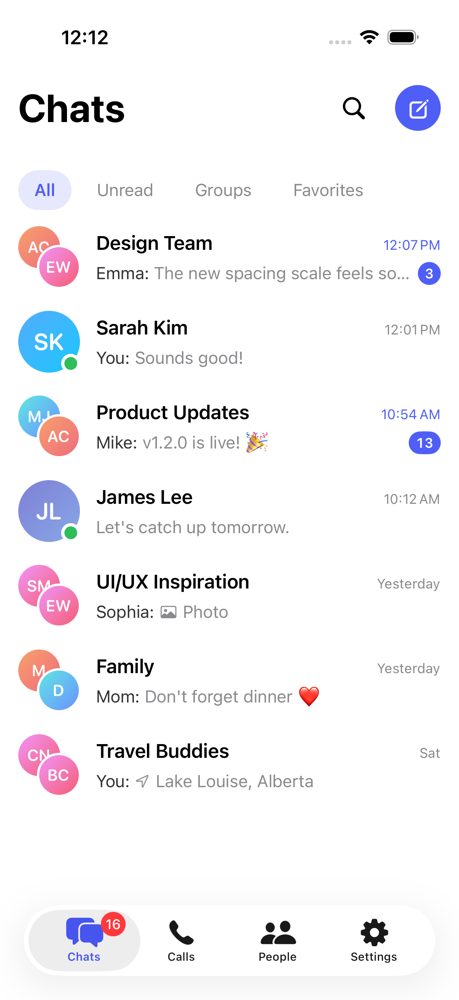

# Md. Zahirul Islam — Senior Mobile Engineer

**iOS · Android · Flutter · React Native**

I bring **10+ years in mobile engineering**, combining commercial app delivery with native and cross-platform development, architecture, testing, performance and release work.

**Open to remote senior mobile roles, long-term contracts and focused freelance projects.**

Currently at **LYNKTO** · Previously remote with **UgoRound Australia** · Dhaka, Bangladesh (UTC+6)

[Discuss a role or project](https://www.linkedin.com/in/zahirul-ios/) · [Portfolio website](https://portfolio-website-three-blue-88.vercel.app/)

## Platform expertise with evidence

| Platform | Engineering focus | Work you can review |
|---|---|---|
| **iOS — Swift, SwiftUI, UIKit** | Features, concurrency, persistence, memory and release engineering | [Commercial delivery](CASE_STUDIES.md#case-01), [merged upstream fixes](CASE_STUDIES.md#case-06), [FlowMoney](https://github.com/devzahirul/FlowMoney-iOS) |
| **Android — Kotlin, Jetpack Compose** | Native UI, background behavior and reusable architecture | [UgoRound location work](CASE_STUDIES.md#case-02), [Attendance HR](https://github.com/devzahirul/AttendenceHRAndroid) |
| **Flutter — Dart, Riverpod** | Modular Clean Architecture, design systems and testable repositories | [Flutter Task Manager](https://github.com/devzahirul/flutter_task_manager), [case study](CASE_STUDIES.md#case-03) |
| **React Native — TypeScript, Expo** | Shared UI, server/client state and native integration | [Four-app portfolio suite](CASE_STUDIES.md#case-04), [public native bridge](https://github.com/devzahirul/Offline_first_location_sync_Mobile/tree/main/rtls-react-native) |

## Six engineering case studies

[Read the complete case studies →](CASE_STUDIES.md) · [Download the portfolio PDF](assets/mobile-engineering-case-studies.pdf)

1. **Commercial iOS & Android delivery** — reusable UI, navigation, testing and production maintenance at LYNKTO.
2. **Background location & geo-alerting** — movement-aware geofence checks and remote mobile delivery for UgoRound.
3. **Flutter architecture** — Riverpod, local packages, Material 3 and optional Firebase repositories.
4. **React Native app suite** — four fixture-backed demos with shared foundations, state boundaries and testing tools.
5. **RTLS native SDK & integration** — location, persistence and synchronization with Flutter/React Native bridges.
6. **Merged open-source fixes** — concurrency, cache I/O and memory management in Kingfisher and Firefox for iOS.

Each case explains the problem, my contribution, technical choices, tradeoffs, outcome and evidence. Commercial work and portfolio demos are identified explicitly.

---

## Open-source contributions

Selected fixes in established iOS projects:

- **[Kingfisher #2539](https://github.com/onevcat/Kingfisher/pull/2539):** fixed a task-cancellation data race in `SessionDataTask.forceCancel()`.
- **[Kingfisher #2556](https://github.com/onevcat/Kingfisher/pull/2556):** removed a redundant file-existence lookup when reading disk-cache metadata. Both changes are credited in the [8.11.0 release notes](https://github.com/onevcat/Kingfisher/releases/tag/8.11.0).
- **[Firefox for iOS #34675](https://github.com/mozilla-mobile/firefox-ios/pull/34675):** fixed a `BoolSetting` retain cycle leaking `AppSettingsTableViewController` and added a regression test.

More upstream pull requests

- [#34569](https://github.com/mozilla-mobile/firefox-ios/pull/34569) **Widgets:** the widget now waits for tab restoration before it closes private tabs, which fixes a state race
- [#34809](https://github.com/mozilla-mobile/firefox-ios/pull/34809) **Dead code:** removed unused `TabManager` code that Periphery flagged
- [#34568](https://github.com/mozilla-mobile/firefox-ios/pull/34568) **Logging:** separated how fatal and non-fatal logs are reported
- [#34553](https://github.com/mozilla-mobile/firefox-ios/pull/34553) **Tests:** telemetry tests now compare objects by identity (`===`) instead of equality
- [#2541](https://github.com/onevcat/Kingfisher/pull/2541) **Concurrency:** fixed a data race on `RetrievingContext.propagationErrors`
- [#2561](https://github.com/onevcat/Kingfisher/pull/2561) **Memory:** the image view is now released while its download is still in progress
- [#2540](https://github.com/onevcat/Kingfisher/pull/2540) **Bug fix:** disk caching now works when the image URL path contains `@`

---

## Selected public projects

Explore my libraries and app projects below. Commercial applications are listed separately.

| Project | Platforms | What it demonstrates | Screenshots / Video |
|---|---|---|---|
| **[FlowMoney: Offline-first Personal Finance](https://github.com/devzahirul/FlowMoney-iOS)** | iOS · Supabase | 16-module SwiftUI app in Swift 6 strict concurrency. Offline ledger sync that preserves edits during in-flight uploads, deterministic recurring transactions, exact integer-based money calculations, budgets and analytics, Supabase RLS, 100+ tests, and CI/CD to TestFlight. |  [Screenshots](https://github.com/devzahirul/FlowMoney-iOS/tree/main/docs/screenshots) |
| **[NovaShop: Offline-first E-commerce](https://github.com/devzahirul/NovaShop-iOS)** | iOS · Supabase | 18-module SwiftUI app in Swift 6 strict concurrency. Local-first cart with state-based sync and reconciliation, a transactional server checkout (Row Level Security, idempotency keys), and launch, CPU and leak profiling on device with Instruments. 115 tests |  [Screenshots](https://github.com/devzahirul/NovaShop-iOS/tree/main/docs/screenshots) |
| **[SwiftHilt](https://github.com/devzahirul/swift_hilt)** | Swift | Dependency injection library that is DAG-aware and inspired by Hilt: scopes, graph validation, test overrides | — |
| **[AsyncSwiftyNetworking](https://github.com/devzahirul/AsyncSwiftyNetworking)** | Swift | async/await networking layer: typed endpoints, retries, interceptors, automated tests | — |
| **[RTLS: Offline-first Location Sync SDK](https://github.com/devzahirul/Offline_first_location_sync_Mobile)** | iOS · Android · Flutter · RN | Modular telemetry SDK: GPS collection, a persistent offline queue, WebSocket real-time sync, pick-only-what-you-need modules | — |
| **[Attendance HR (Android)](https://github.com/devzahirul/AttendenceHRAndroid)** | Android | Compose + clean architecture, multi-module, CI | — |

More projects and SDK demonstrations

| Project | Platforms | What it demonstrates | Screenshots / Video |
|---|---|---|---|
| **ChatApp (ConvoKit): Native Chat SDK** Source currently private | iOS · Android · Flutter (iOS bridge) | Backend-agnostic SDK with native SwiftUI and Jetpack Compose UIs. Actor / coroutine-based offline outbox, SQLite caching and message search, direct and group chat, invitations, streaming AI, and Supabase RLS. Flutter wraps the native iOS SDK. |  [Screenshots](assets/chatapp/README.md) · [Video](https://github.com/devzahirul/devzahirul/raw/refs/heads/main/assets/chatapp/convo-walkthrough.mp4) |
| **[KinBeacon: Family Safety & Parental Controls](https://devzahirul.github.io/KinBeacon-iOS/#experience)** Source currently private | iOS · Supabase | 30-module SwiftUI app in Swift 6 strict concurrency. Battery-aware background location and safe places, Apple Screen Time schedules with four extensions, check-ins and SOS, APNs remote commands, and a durable SwiftData outbox. Parent and child device pairing with RLS-protected family data. | [Screenshots / live gallery](https://devzahirul.github.io/KinBeacon-iOS/#experience) |
| **[PlaceAlertMe](https://github.com/devzahirul/PlaceAlertMe)** | iOS | Background geofencing and location-based alerts | — |
| **[TDD High-Performance E-commerce](https://github.com/devzahirul/TDDHighPerformance-ecommerceSwiftui)** | iOS | Test-driven SwiftUI with a focus on rendering performance | — |

---

## Shipped to production

Selected commercial apps I worked on for clients and employers:

| App | Highlights | Link |
|---|---|---|
| **AISocial – AI Assistant** | LLM chat, PDF summarization, subscriptions, Share Extension, Widgets, Firebase, modular SPM, unit/UI/snapshot tests, CI | [App Store](https://apps.apple.com/us/app/aisocial-ai-assistant-ai-chat/id6446788161) |
| **Alloy Sports – Betting Companion** | Subscriptions, modular architecture, snapshot tests, GitHub Actions CI | [App Store](https://apps.apple.com/au/app/alloy-sports-betting-companion/id1624936582) |
| **Davi & Dani – Wholesale Shop** | E-commerce, payments, offline catalog (Core Data) | [App Store](https://apps.apple.com/qa/app/davi-and-dani-wholesale-shop/id6444211395) |
| **Adora Los Angeles** | E-commerce, payments | [App Store](https://apps.apple.com/us/app/adora-los-angeles/id6470774390) |
| **Mello USA** | E-commerce, Stripe | [App Store](https://apps.apple.com/us/app/mello-usa/id6451467071) |
| **StylePick** | E-commerce, Stripe | — |
| **Wholesale Scan** | Barcode/QR scanning, business-card OCR with Gemini, PDF printing, server sync | Internal |

📸 Screenshots

---

## Core tools

**iOS:** Swift 6 · SwiftUI · UIKit · Swift Concurrency · Combine · Core Data / SwiftData · SPM modularization · WidgetKit · Extensions · StoreKit
**Android:** Kotlin · Jetpack Compose · Coroutines / Flow · Hilt · Room · WorkManager · multi-module Gradle
**Cross-platform:** Flutter · Dart · Riverpod · React Native · TypeScript · Expo · TanStack Query · Zustand
**Quality & delivery:** XCTest / swift-testing · JUnit · snapshot & UI tests · TDD · GitHub Actions · Fastlane · SwiftLint / ktlint

---

## How I work

- **Architecture first:** modular (SPM / Gradle multi-module), unidirectional data flow, clear domain boundaries, and DI that stays testable.
- **Tests I trust:** TDD where it pays off, plus snapshot tests for UI and CI that gates every PR.
- **Background and offline:** geofencing, background location, sync queues that survive process death and a bad network.
- **Shipping:** I own releases (signing, TestFlight / Play tracks, phased rollouts, crash monitoring).
- **Sharing:** knowledge and reusable libraries (SwiftHilt, AsyncSwiftyNetworking, [Swift design patterns](https://github.com/devzahirul/oop_design_patterns_swift)).

**Hiring or planning an app project?** Reach me on [LinkedIn](https://www.linkedin.com/in/zahirul-ios/)
